<div align="center">

# 🚀 Axion Cloud Infrastructure

### End-to-end GitOps platform on Azure: Terraform → GitHub Actions → ArgoCD → AKS, observed with Prometheus & Grafana


</div>

---

## 🎬 See it running

Auto-playing previews (sped up). Click any preview to open the full screen recording of the live environment, recorded 10 Nov 2026.

**1. GitOps in ArgoCD**: the root app manages `axion-dev`, `axion-prod` and `monitoring`, all **Healthy** and **Synced**.

[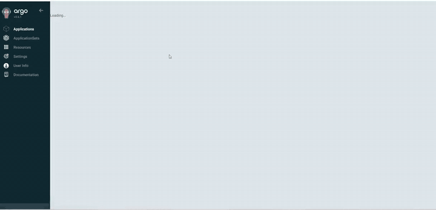](docs/demo/argocd-gitops-sync.mp4)

**2. The application, live on AKS**: telemetry dashboard fed by the simulator → ingestion → PostgreSQL pipeline running in the cluster.

[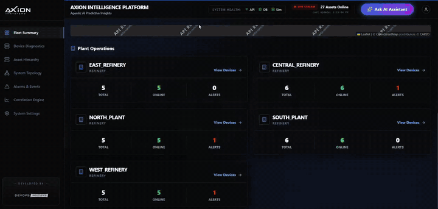](docs/demo/axion-ui-live-demo.mp4)

**3. Prometheus and Grafana**: per-namespace CPU, memory and network dashboards from kube-prometheus-stack.

[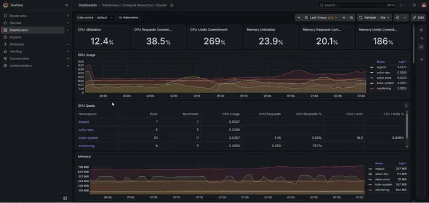](docs/demo/grafana-prometheus-monitoring.mp4)

---

## 📌 Overview

A `git push` is the only thing a developer does. Everything after that is automated and auditable:

1. **GitHub Actions** builds a container image, tags it with the commit SHA and pushes it to **Azure Container Registry**.
2. The pipeline commits the new tag into the Kustomize overlay in this same repo (`[skip ci]`, so no build loops).
3. **ArgoCD** (app-of-apps) notices the commit, syncs it to **AKS** and keeps the cluster matching Git, with self-heal and pruning.
4. **Prometheus and Grafana**, also deployed through ArgoCD, show the health of the cluster and of every namespace.

All cloud infrastructure (resource group, ACR, AKS and the Terraform remote-state backend) is defined as code and can be recreated from scratch with a few commands.

> **Scope:** the workload is the *Axion Intelligence Platform* (a telemetry dashboard for industrial assets). This repository focuses on the delivery platform around it: infrastructure, CI/CD, GitOps, environments and observability.

### ✨ What this project demonstrates

| Area | What's implemented |
|---|---|
| **Infrastructure as Code** | Modular Terraform (resource group, ACR, AKS) with remote state in Azure Blob Storage, bootstrapped by a separate state stack |
| **CI** | One path-filtered GitHub Actions workflow per service, SHA-tagged images, build cache, serialized manifest updates |
| **GitOps CD** | ArgoCD app-of-apps, scoped `AppProject`s, automated sync with self-heal and prune |
| **Environments** | `axion-dev` and `axion-prod` from one Kustomize base with per-environment overlays and a scripted promotion flow |
| **Observability** | kube-prometheus-stack managed by ArgoCD: Prometheus, Grafana, kube-state-metrics, node-exporter |
| **Traceability** | Every running image tag maps to a Git commit; every cluster change maps to a Git commit |

---

## 🏗️ Architecture

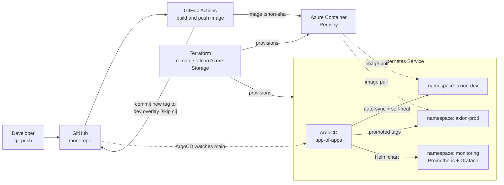

### Application data flow

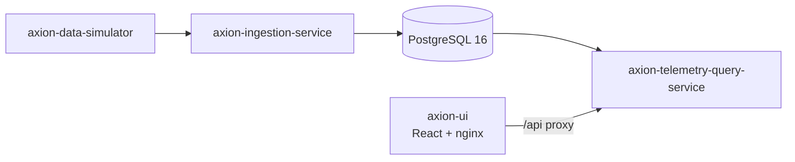

### Environments

| Namespace | Purpose | How changes arrive |
|---|---|---|
| `axion-dev` | Latest builds | CI commits the new image tag to `k8s/overlays/dev`; ArgoCD auto-syncs |
| `axion-prod` | Promoted releases | `scripts/promote-to-prod.ps1` copies verified dev tags into `k8s/overlays/prod` as an explicit Git commit |
| `monitoring` | Observability stack | kube-prometheus-stack Helm chart (version pinned) deployed by ArgoCD |
| `argocd` | GitOps controller | Installed once; `bootstrap/root.yaml` then manages everything else from Git |

---

## 🧰 Tech stack

| Layer | Tools |
|---|---|
| Cloud | Azure Kubernetes Service (AKS), Azure Container Registry (ACR), Azure Storage (Terraform state) |
| Infrastructure as Code | Terraform with the `azurerm` provider |
| CI | GitHub Actions |
| CD / GitOps | ArgoCD, Kustomize (base + overlays) |
| Observability | Prometheus, Grafana, kube-state-metrics, node-exporter (kube-prometheus-stack) |
| Containers | Docker, one image per service |
| Application | React + TypeScript + Vite (served by nginx), Python services, PostgreSQL 16 |

---

## 📸 Proof of work

### ArgoCD: app-of-apps, all Healthy and Synced

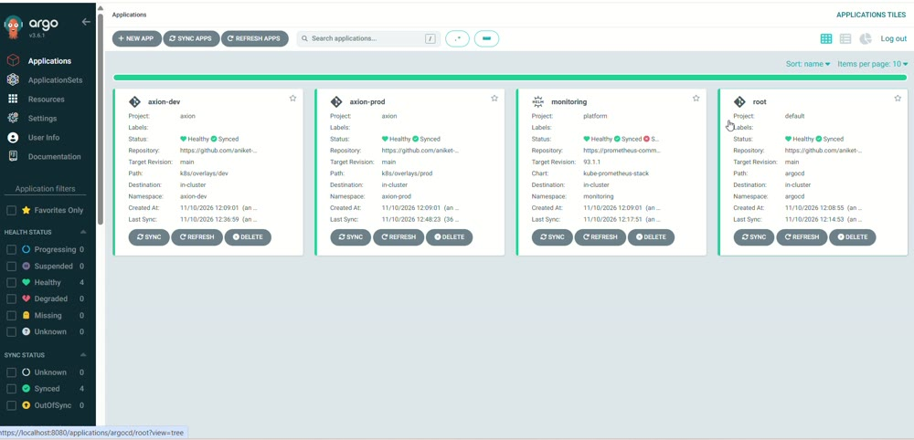

`root` manages `axion-dev`, `axion-prod` and `monitoring` (Helm chart `kube-prometheus-stack`). Each one is a Git-tracked `Application`.

### CI to GitOps loop in the Git history

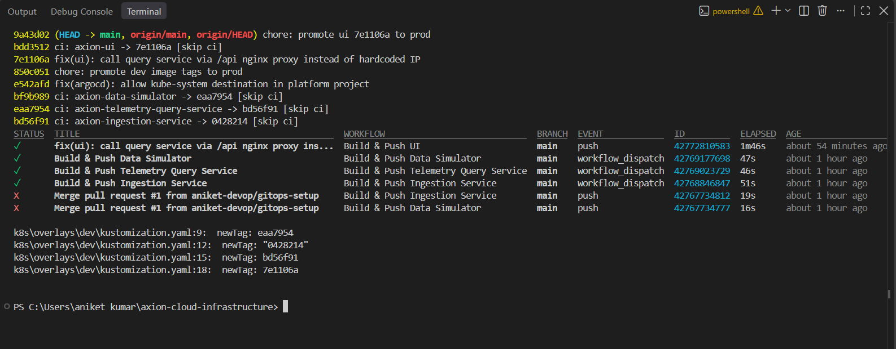

The bot commits (`ci: axion-ui -> 7e1106a [skip ci]`) are the pipeline writing the new image tag, and the `chore: promote ... to prod` commits are the explicit promotion step. Image tags are Git SHAs, so any running pod can be traced to its source commit. The workflow runs below show the builds finishing in about 45 to 50 seconds for the Python services and about 1 min 46 s for the UI.

### Workloads and services on the cluster

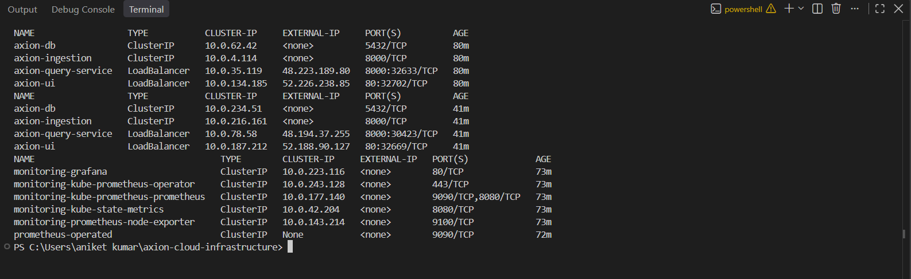

Databases and the ingestion service stay internal (`ClusterIP`), and only the UI and query service are exposed. The monitoring stack runs in its own namespace.

### Data flowing end to end

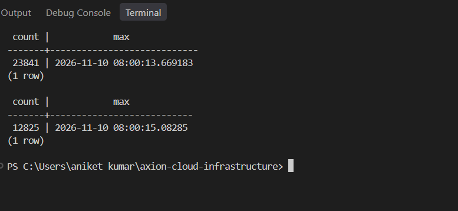

Row counts and latest timestamps queried straight from PostgreSQL show the simulator → ingestion → database path is live.

### Grafana: cluster metrics per namespace

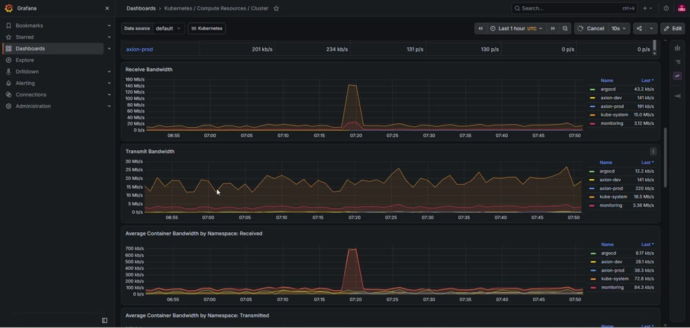

The built-in *Kubernetes / Compute Resources / Cluster* dashboard breaks usage down by `argocd`, `axion-dev`, `axion-prod`, `kube-system` and `monitoring`.

### The application

| | | |
|:---:|:---:|:---:|
| 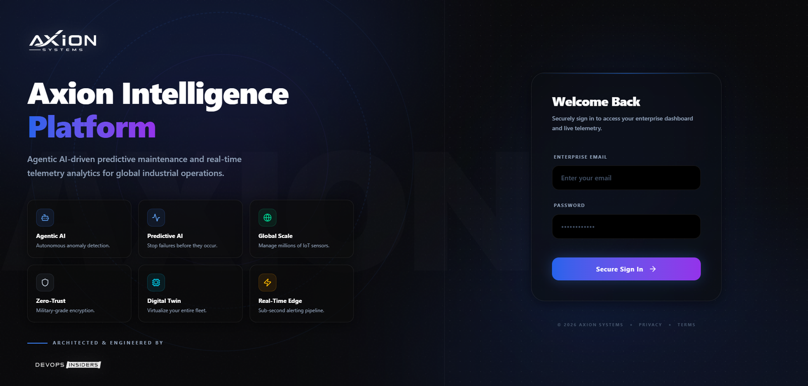 | 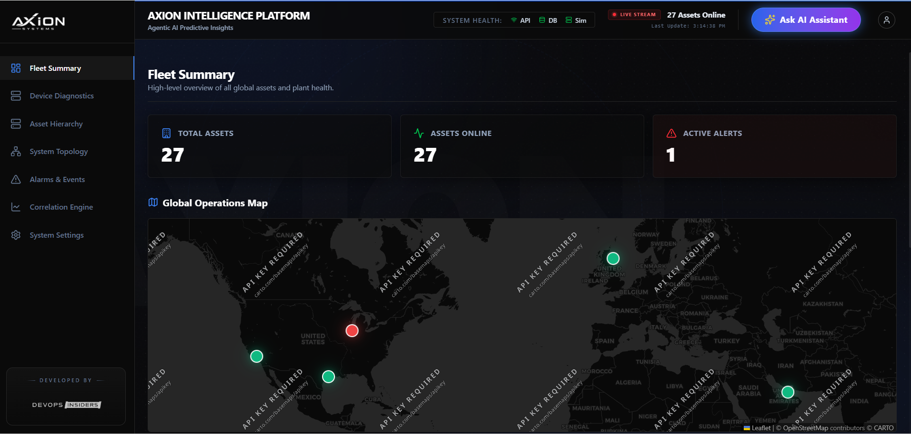 | 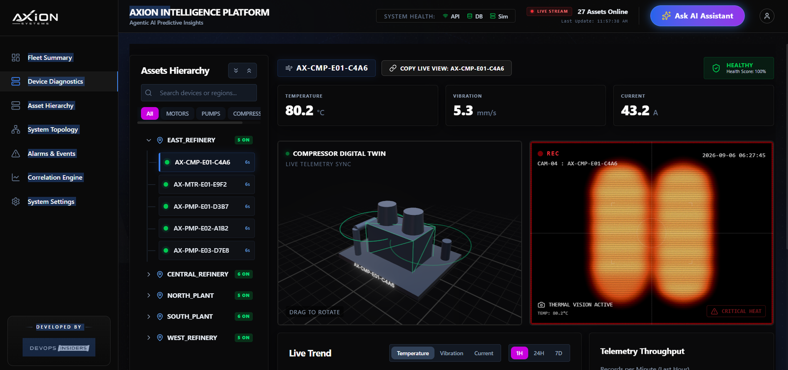 |
| Login | Fleet summary | Device diagnostics: compressor digital twin and thermal view |
| 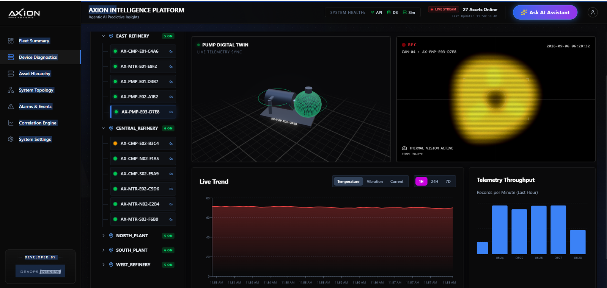 | 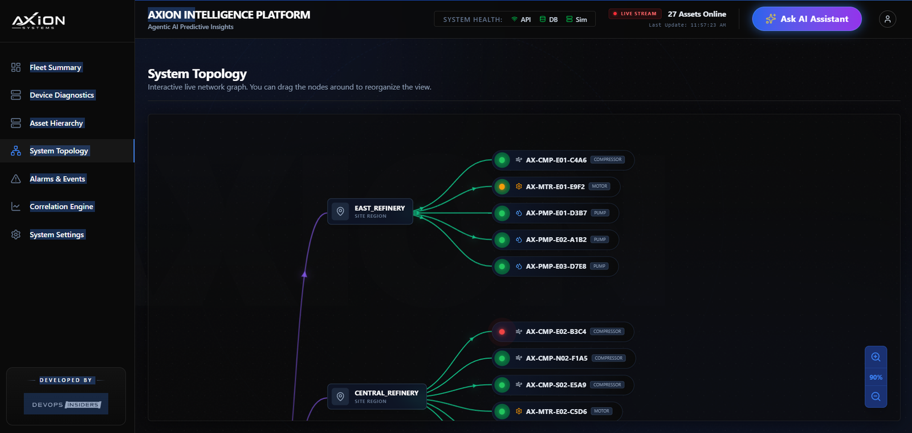 | 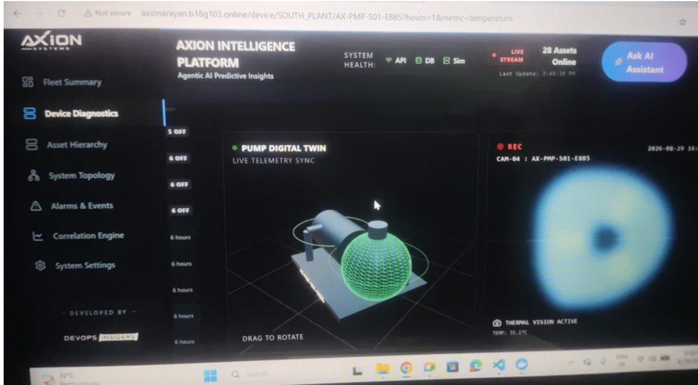 |
| Pump digital twin, live trend and throughput | System topology | Custom domain |

<sub>The application screenshots were captured from earlier AKS deployments of this stack (Aug to Sep 2026). The pipeline, ArgoCD and Grafana proof above is from the 10 Nov 2026 environment.</sub>

---

## 📁 Repository structure

```
axion-cloud-infrastructure/
├── .github/workflows/        # one build-push workflow per service + infrastructure-deploy
├── terraform/                # RG + ACR + AKS (modules/), environments.tfvars
├── state-infrastructure/     # bootstraps the Azure Storage account used as Terraform backend
├── k8s/
│   ├── base/                 # postgres, ingestion, query-service, simulator, ui
│   └── overlays/{dev,prod}/  # image tags, namespace, pull-secret patch
├── argocd/
│   ├── projects/             # AppProjects: axion (apps), platform (monitoring)
│   └── apps/                 # Applications: axion-dev, axion-prod, monitoring
├── bootstrap/root.yaml       # the only thing applied by hand: ArgoCD root app
├── scripts/                  # promote-to-prod.ps1
├── axion-ui/                 # React + TypeScript + Vite, nginx
├── axion-ingestion-service/
├── axion-telemetry-query-service/
├── axion-data-simulator/
├── axion-database-schema/    # SQL init scripts
└── docs/                     # screenshots and demo videos
```

---

## 🔄 How the pipeline works

**Build (per service, GitHub Actions)**

- Triggered only when that service's folder or its own workflow file changes, so an edit to one service never rebuilds the others.
- Builds the image with Buildx and layer cache, tags it with the short commit SHA and pushes it to ACR.
- A second job updates `k8s/overlays/dev/kustomization.yaml` via `kustomize edit set image`, commits as the Actions bot with `[skip ci]` and pushes.
- A `concurrency` group serializes manifest updates, so two services finishing at the same time cannot overwrite each other's tag.

**Deploy (ArgoCD)**

- `bootstrap/root.yaml` points at `argocd/` and recursively creates the AppProjects and Applications.
- `axion-dev` and `monitoring` use automated sync with `prune` and `selfHeal`, so manual `kubectl` drift is reverted.
- Two AppProjects separate concerns: `axion` is limited to this repo and the app namespaces, while `platform` is allowed to install Helm charts from the Prometheus community repo.

**Promote**

- `scripts/promote-to-prod.ps1` reads the four tags from the dev overlay, refuses to continue if any is still the placeholder `initial`, and writes them to the prod overlay. The promotion is a normal Git commit, so it is reviewable and revertible.

---

## 🧠 Engineering decisions and lessons

- **No hardcoded IPs in the UI.** The UI originally called the query service by load-balancer IP. It now goes through an `/api` proxy in nginx, so the frontend survives any IP change and works the same in every environment.
- **Least-privilege GitOps.** Applications and platform tooling live in separate `AppProject`s. The `platform` project also needed `kube-system` as an allowed destination because kube-prometheus-stack ships a few objects there. That was fixed with a dedicated commit once the first sync surfaced it.
- **Loop-proof CI.** Path filters, `[skip ci]` and the serialized manifest job together prevent the classic "CI commits to the repo that triggers CI" loop.
- **Pinned versions.** Terraform provider, Kubernetes version and the Helm chart version are pinned, so rebuilds are reproducible.
- **Secrets stay out of Git.** The registry pull secret (`acr-secret`) and the Grafana admin credentials (`grafana-admin`) are created in the cluster out-of-band.
- **Role-assignment constraint.** The Azure subscription used for this build did not allow creating role assignments, so AKS-to-ACR access uses ACR admin credentials with a namespaced `imagePullSecret`. That is a deliberate, documented trade-off; the target design (below) replaces it with managed identity and OIDC.
- **Remote state from day one.** Terraform state lives in a private blob container created by its own small stack (`state-infrastructure/`), avoiding the chicken-and-egg problem.

---

## 🚀 Getting started

**Prerequisites:** Azure subscription, `az`, `terraform` (>= 1.6), `kubectl`, `gh`, and optionally `helm`. If you fork this repo, update the `repoURL` in `argocd/apps/*.yaml` and `bootstrap/root.yaml`, and choose your own globally unique ACR name in `terraform/environments.tfvars`, the workflows and the overlays.

```bash
# 0. Login and subscription (azurerm v4 needs the subscription id)
az login
export ARM_SUBSCRIPTION_ID=$(az account show --query id -o tsv)

# 1. Terraform remote-state backend (one time)
cd state-infrastructure
terraform init && terraform apply

# 2. Core infrastructure: resource group, ACR, AKS
cd ../terraform
terraform init
terraform apply -var-file=environments.tfvars

# 3. Connect to the cluster
az aks get-credentials -g rg-axion-dev -n aks-axion-dev

# 4. Registry credentials for CI and for the cluster
ACR=axionacraniket1026
ACR_USER=$(az acr credential show -n $ACR --query username -o tsv)
ACR_PASS=$(az acr credential show -n $ACR --query "passwords[0].value" -o tsv)
echo "$ACR_USER" | gh secret set ACR_USERNAME
echo "$ACR_PASS" | gh secret set ACR_PASSWORD
for ns in axion-dev axion-prod; do
  kubectl create namespace $ns --dry-run=client -o yaml | kubectl apply -f -
  kubectl create secret docker-registry acr-secret -n $ns \
    --docker-server=$ACR.azurecr.io --docker-username="$ACR_USER" --docker-password="$ACR_PASS"
done

# 5. Build the images: run each "Build & Push" workflow once (Actions tab), one at a time.
#    Each run commits its image tag into k8s/overlays/dev.

# 6. Install ArgoCD and the Grafana admin secret
kubectl create namespace argocd
kubectl apply -n argocd --server-side -f https://raw.githubusercontent.com/argoproj/argo-cd/stable/manifests/install.yaml
kubectl create namespace monitoring
kubectl create secret generic grafana-admin -n monitoring \
  --from-literal=admin-user=admin --from-literal=admin-password='<choose-a-strong-password>'

# 7. Hand the cluster over to Git
kubectl apply -f bootstrap/root.yaml
```

**Open the UIs**

```bash
# ArgoCD  -> https://localhost:8080   (user: admin)
kubectl port-forward svc/argocd-server -n argocd 8080:443
kubectl -n argocd get secret argocd-initial-admin-secret -o jsonpath="{.data.password}" | base64 -d

# Grafana -> http://localhost:3000
kubectl port-forward svc/monitoring-grafana -n monitoring 3000:80
```

**Promote dev to prod** (PowerShell 7)

```powershell
./scripts/promote-to-prod.ps1
git add k8s/overlays/prod && git commit -m "chore: promote dev image tags to prod" && git push
```

---

## 💸 Cost and teardown

The environment is ephemeral by design: `terraform apply` plus `kubectl apply -f bootstrap/root.yaml` rebuilds everything, and cloud resources are destroyed after validation to avoid ongoing cost. To pause without destroying, run `az aks stop -g rg-axion-dev -n aks-axion-dev`.

```bash
cd terraform && terraform destroy -var-file=environments.tfvars
cd ../state-infrastructure && terraform destroy     # last, it holds the state of the stack above
```

---

## 🗺️ Roadmap

- [ ] Liveness/readiness probes, resource requests and limits, HPA and PodDisruptionBudgets
- [ ] ingress-nginx with cert-manager TLS instead of per-service load balancers
- [ ] Trivy image scanning in CI, branch protection and an approval gate for prod
- [ ] Azure Key Vault with External Secrets; managed identity and OIDC (`AcrPull`, GitHub federated login) instead of ACR admin credentials
- [ ] Alertmanager rules and `ServiceMonitor`s for application-level metrics
- [ ] Automated, PR-based promotion from dev to prod
- [ ] PostgreSQL backups (or Azure Database for PostgreSQL) and a restore test
- [ ] Separate production cluster, NetworkPolicies and ArgoCD SSO

---

## 👤 Author

**Aniket Kumar**: DevOps / Cloud engineer working with Azure, Terraform, Kubernetes and CI/CD.
GitHub: [@aniket-devop](https://github.com/aniket-devop)

If this project was useful or interesting, a ⭐ on the repo is appreciated.
